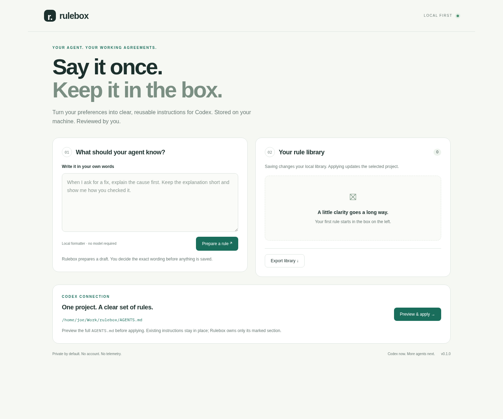

# Rulebox

**Say it once. Keep it in the box.**

A small, local-first instruction manager for **Codex**, built with Python, SQLite and a browser UI. Write a preference, review its wording, save it once, and apply it to a project's `AGENTS.md`.



Rulebox also includes an optional **LoRA training and inference path** for a local rule-writing model. That model proposes instructions; you review them before they reach Codex. It does **not** fine-tune hosted Codex or guarantee that an agent follows every instruction.

## Quick start

Requires Python 3.11+. The basic app has **no third-party runtime dependencies**.

```bash
git clone https://github.com/Josephsjr96/rulebox.git
cd rulebox
python -m rulebox --project /absolute/path/to/your/project --open
```

Open **http://127.0.0.1:8765** if the browser does not open. The project must already exist. For a harmless first run, create an empty folder and point `--project` there.

Alternatively, install the CLI into a virtual environment:

```bash
python -m venv .venv
source .venv/bin/activate
python -m pip install -e .
rulebox --project /absolute/path/to/your/project --open
```

On Windows, activate with `.venv\Scripts\activate`. No Codex API key is required. Stop the local server with Ctrl+C.

## The workflow

1. Write a preference in your own words.
2. Choose **Prepare a rule**, then edit the title and instruction.
3. Save to your SQLite library. Edit, disable or delete rules as needed.
4. Choose **Preview & apply** to inspect the complete current and proposed files.
5. Apply the exact preview. Start a **new Codex session** in the selected project.

Without a local model, the draft step only normalizes formatting. It deliberately preserves the original meaning rather than pretending to perform AI rewriting. With `--base` and `--adapter`, drafts come from your local LoRA model and remain subject to review.

Saving does not change Codex automatically. Disabling or deleting a rule also requires applying again. The library is shared across project launches; enabled rules are applied to the one project selected on startup. Per-project rule collections are a future feature.

### What happens to existing instructions?

Rulebox manages only the region between `<!-- rulebox:start -->` and `<!-- rulebox:end -->`. Text outside it is preserved. It backs up an existing file as `.rulebox-backup-<timestamp>.md` before replacement, rejects stale previews and refuses symlinked files or malformed markers. Restore by stopping Rulebox and copying the desired backup over `AGENTS.md`.

An `AGENTS.override.md` in the selected directory takes precedence, so Rulebox refuses to apply until you resolve it. Nested overrides, global instructions, higher-priority policies and Codex's instruction-size budget can affect what is loaded. Rulebox is instruction management, not a security enforcement engine or a voice-recognition gate. See [official Codex instruction discovery documentation](https://developers.openai.com/codex/guides/agents-md).

## Local storage and privacy

By default, the library lives at `~/.local/share/rulebox/rules.sqlite3`, outside the Git repository. Choose another location with `--db /path/to/rules.sqlite3`. Export a portable JSON snapshot from the UI; JSON import is not implemented in v0.1.

The server binds only to `127.0.0.1`. It checks Host and Origin and requires a per-launch token for mutations. It has no telemetry, external scripts, remote fonts or hosted model calls. Do not expose this development server to the internet; local processes running as your user remain trusted. A same-user malicious process can access your files regardless of the UI protections.

Instructions and backups are plain text. Do not store passwords or API keys in rules. Applying instructions places them inside the selected project, where Git may include them. The repository's ignore file excludes its local databases, adapters, private datasets and backup files; add equivalent patterns to other target projects if needed.

## Optional LoRA rule writer

LoRA trains small adapter matrices around a compatible base model while keeping its original weights frozen. In Rulebox, the training task is **preference → clear instruction**. The resulting adapter changes the local writer, not Codex. Adding a normal rule does not trigger retraining.

```bash
python -m pip install -e '.[lora]'
python -m rulebox.lora \
  --base /path/to/local/causal-language-model \
  --data private-data/reviewed-pairs.jsonl \
  --output adapters/rule-writer \
  --targets q_proj,v_proj --rank 8 --epochs 3

python -m rulebox \
  --project /path/to/project \
  --base /path/to/the/same/base-model \
  --adapter adapters/rule-writer --open
```

Training accepts a local model directory or an explicitly chosen Hugging Face Hub ID. A Hub ID may download large model files. Select a model whose license, memory needs and module names suit your environment; the default target names fit some architectures, not all. Training is not launched from the browser. Serving uses local files only and does not download missing models.

Each JSONL line needs `source` and `instruction`. `examples/training.jsonl` and `examples/heldout.jsonl` are small **format demonstrations**, not a production training corpus. Prepare a substantial, diverse, reviewed dataset and keep validation examples separate. Preserve exceptions, negations, language choices and scope. Never silently strengthen a preference into new permissions.

Training masks prompt tokens in the loss, rejects examples that exceed the length limit, freezes base parameters through PEFT, and saves adapter weights plus a training manifest. Training loss alone does not establish quality. Review held-out outputs for fidelity, invented requirements, missing exceptions and unwanted permission changes before enabling the model. No quality-validated adapter is bundled.

References: [Hugging Face PEFT LoRA guide](https://huggingface.co/docs/peft/main/task_guides/lora_based_methods), [PEFT documentation](https://huggingface.co/docs/peft).

## Development and tests

```bash
python -m unittest discover -s tests -v
```

Tests cover SQLite persistence, rule changes, file preservation, backups, stale previews, marker corruption, symlinks, overrides, training-data masking and HTTP protections. Optional training requires the `lora` dependencies; core tests do not. CI runs the core suite on Python 3.11–3.13.

After installing the LoRA extra, run `python tests/lora_smoke.py` for an offline training/save/reload/inference smoke test using a tiny randomly initialized model. This checks adapter mechanics and frozen base weights; it is not a model quality benchmark.

```text
rulebox/core.py        SQLite library and Codex adapter
rulebox/server.py      Loopback UI server
rulebox/lora.py        Optional LoRA training and local inference
rulebox/static/        Browser UI; no frontend build step
examples/             Synthetic dataset format examples
tests/                Core and HTTP integration tests
```

## Roadmap

- **v0.1:** local library, reviewable Codex integration, optional LoRA writer tooling.
- **Next:** per-project collections, import, history and instruction-fidelity evaluation.
- **Later:** documented adapters for Hermes and other agents. These integrations are not implemented yet.

Contributions are welcome. Please include a reproducible case and tests for behavior changes. Keep runtime dependencies optional and document which files an integration can modify.

## License

[MIT](LICENSE) © 2026 Yousef (Joseph) Sanjari. Third-party model weights and dependencies retain their own licenses. Rulebox is an independent project, not an official OpenAI product.
